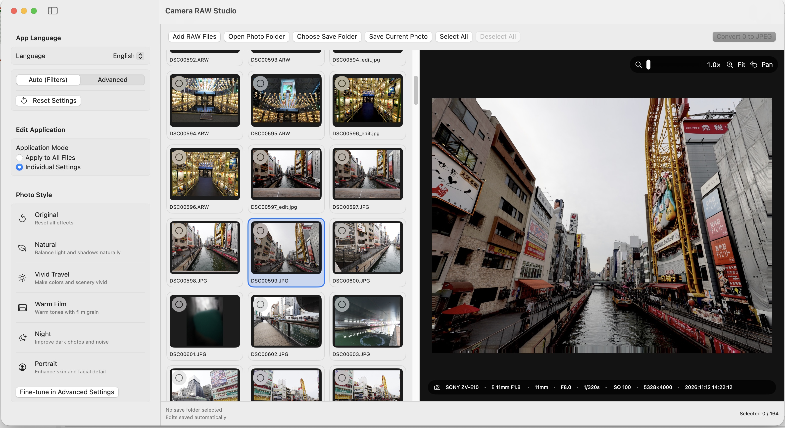

# Camera RAW Studio for macOS

Sony ZV-E10의 ARW 사진을 로컬에서 JPEG로 일괄 현상하는 macOS 앱입니다. 원본 파일은 수정하지 않습니다.



## 현재 기능

- Sony ARW/DNG/JPEG 파일 다중 선택
- 선택한 사진 폴더와 하위 폴더에서 지원 파일 자동 검색
- 여러 사진의 빠른 썸네일 갤러리와 선택 사진의 보정 미리보기
- 체크한 여러 사진만 선택적으로 JPEG 변환
- 저장 폴더 선택창을 현재 입력 사진 폴더에서 시작
- Sony E 11mm F1.8 기본 렌즈 프로필
- 렌즈 프리셋 선택 및 사용자 렌즈 입력
- 노출, 대비, 채도, JPEG 품질 조절
- RAW 촬영 화이트밸런스를 기준으로 색온도와 틴트 조절(JPEG에는 미적용)
- 별도 AI 품질 향상 옵션에서 Restormer 로컬 노이즈 제거와 약하게/보통/강하게 조절
- AI 미리보기는 빠른 해상도로 처리하고 JPEG 저장은 원본 크기로 처리
- 수평 맞추기용 ±10° 미세 회전과 검은 모서리 자동 크롭
- 모든 사진 공통 편집과 사진별 개별 편집 모드 선택
- 사진 폴더별 편집 내용과 변환 대상 자동 저장 및 재실행 복원
- 현재 사진을 원본과 분리된 `_edit.jpg` 파일로 안전하게 저장
- 선택한 폴더에 JPEG 일괄 저장
- 앱 안에서 시스템 설정·한국어·영어·일본어·중국어(간체)를 즉시 전환하고 선택 언어 유지

## 실행

```sh
swift run CameraImageWorker
```

일반 macOS 앱으로 만들기:

```sh
chmod +x scripts/build-app.sh
./scripts/build-app.sh
open "dist/Camera RAW Studio.app"
```

응용 프로그램 폴더에 설치:

```sh
chmod +x scripts/install-app.sh
./scripts/install-app.sh
```

설치 후 Launchpad, Spotlight 또는 Finder의 응용 프로그램에서 `Camera RAW Studio`를 실행할 수 있습니다.

영상 자동 편집은 다음 단계에서 같은 앱의 별도 작업 화면으로 추가할 예정입니다.
